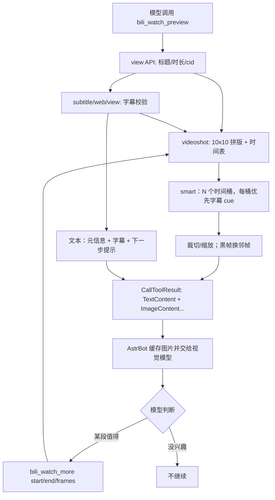

<div align="center">
  
  <h1>BiliWatch · B 站分阶段看视频</h1>
  <p>先看 10 帧 + 字幕，再由模型自己决定看哪段 / 全片</p>
  <p>
    <strong>AstrBot</strong> ≥ 4.22 · <strong>License</strong> MIT ·
    <a href="README_en.md">English</a>
  </p>
</div>

---

## 这是什么

大多数 B 站插件只给模型**字幕**，或者按固定配置抽几张图；模型没有机会“先看看，再决定要不要细看”。

BiliWatch 把“看视频”拆成两次工具调用：

1. **`bili_watch_preview`**：抽 10 张关键帧 + 字幕，给模型一个整片概览；
2. **`bili_watch_more`**：模型觉得某段有意思，就传 `start` / `end` / `frames` 继续抽；想看全片就 `start=0, end=0`。

单次抽帧上限由配置 `max_frames` 控制；设为 `0` 表示允许返回视频的**全部快照**。

它不下载整段视频，不依赖 `ffmpeg` / `yt-dlp`，只读 B 站公开视频信息、官方快照拼版和字幕。

## 特性

- **两阶段、模型自选**：先预览，再决定是否细看、看哪段。
- **轻依赖**：只用 AstrBot 自带的 `aiohttp` / `Pillow` / `mcp`；不需要 ffmpeg、yt-dlp、浏览器。
- **不下载视频**：直接使用 B 站官方 `videoshot` 快照拼版，快速、省磁盘。
- **字幕全读，画面选看**：`subtitle_max_chars=0` 默认给字幕全文；画面只按 `initial_frames` / `max_frames` 选着看，不会为了省 token 把字幕砍掉。
- **字幕校验**：优先走按 aid/cid 查询的新字幕接口；时间轴明显超过视频时长就丢弃，避免拿到别的视频字幕。
- **smart 选帧**：把全片切成 N 个时间桶，每个桶优先挑字幕 cue；字幕全挤在开头也会覆盖到结尾。
- **黑帧过滤**：接近全黑的镜头会尝试前后 1–3 个快照，避免“抽到黑屏”。
- **字幕对齐**：返回字幕 cue 数量；模型引用时间点时知道对应哪句台词。
- **上限可配**：`max_frames=0` 允许全部快照；也可以限制 20 / 40 / 60 张。
- **只读安全**：不评论、不发动态、不操作 B 站账号。
- **短缓存**：同一进程内快照/字幕缓存 5 分钟，减少连续 preview → more 的风控概率。
- **不假装有声音**：本插件听不到 BGM / 语气；需要声音请用独立 ASR 方案。

## 和现有 B 站工具的关系

BiliWatch **只新增两个 LLM 工具**，不会替换、禁用或修改你已有的 B 站 MCP 工具：

- 现有 `bili_subtitle`：继续可用；BiliWatch 的预览里也会附带字幕，两者不冲突。
- 现有 `bili_danmaku`：继续可用；BiliWatch 不抓弹幕，想看弹幕仍调用它。
- 现有 `bili_comments` / `bili_rank` / `bili_hot_videos` 等：完全不受影响。

建议分工：**画面用 BiliWatch，弹幕/评论用原 MCP**；同一个视频不要短时间反复 preview + more + danmaku，避免 B 站风控。

## 前置条件

| 条件 | 是否必需 | 说明 |
|---|---|---|
| AstrBot | 必需 | `>=4.22,<5`，实测 `4.29.1` |
| 支持图片输入的聊天模型 | 必需 | 插件把关键帧作为图片交给主模型；纯文本模型看不到画面 |
| B 站 Cookie | 可选，字幕推荐 | 放在 `bili_credential.json`；不配也能取快照，但字幕通常为空 |
| 网络 | 必需 | 能访问 `api.bilibili.com`、`i0.hdslb.com`、`aisubtitle.hdslb.com` |
| ffmpeg / yt-dlp | 不需要 | 本插件不下载视频 |
| 前置插件 | 无 | 不依赖其他 AstrBot 插件 |

> 如果你用 DeepSeek，建议使用支持视觉的 `deepseek-flash`（本项目实测环境）。模型不支持图片时，插件仍会返回图片，但模型无法理解画面。

### Cookie 文件格式

默认读取 `data/plugin_data/astrbot_plugin_bili_watch/bili_credential.json`（相对路径，Linux / Windows 通用），也可以在插件配置里填绝对路径：

```json
{
  "sessdata": "你的 SESSDATA",
  "bili_jct": "你的 bili_jct",
  "buvid3": "可选",
  "dedeuserid": "你的 DedeUserID"
}
```

可以复用 `adoresever/bilibili-mcp` 的凭证文件；也可以从浏览器登录 B 站后，在开发者工具 → Application → Cookies 里复制 `SESSDATA`、`bili_jct`、`DedeUserID`。

## 安装

### 插件市场（发布后）

在 AstrBot 插件市场搜索 **BiliWatch** / **B站分阶段看视频** 安装。

### 从 GitHub 手动安装

```bash
cd ~/.astrbot/data/plugins
git clone https://github.com/QKqiuku/astrbot_plugin_bili_watch.git
```

Windows 默认目录：

```text
C:\Users\<你>\.astrbot\data\plugins\astrbot_plugin_bili_watch
```

### 从 zip 安装

把 `astrbot_plugin_bili_watch.zip` 解压，确保最终目录里直接有 `main.py`：

```text
astrbot_plugin_bili_watch/
├── main.py
├── bili_core.py
├── metadata.yaml
├── _conf_schema.json
├── requirements.txt
├── README.md
├── README_en.md
├── LICENSE
├── CHANGELOG.md
└── logo.png
```

然后在 AstrBot 插件页点击 **重载插件**，或重启 AstrBot。

## 配置

在 AstrBot → 插件 → **BiliWatch · B站分阶段看视频** 中配置：

| 配置项 | 默认 | 说明 |
|---|---|---|
| `initial_frames` | `10` | 第一次概览抽多少帧；建议 6–10 |
| `max_frames` | `40` | 第二次续看单次上限；`0` = 允许全部快照 |
| `subtitle_max_chars` | `0` | `0` = 字幕全文（推荐）；只有上下文很紧时才填正数截断 |
| `selection_mode` | `smart` | `smart` = 字幕节点 + 时间覆盖；`even` = 纯等间隔 |
| `avoid_dark` | `true` | 黑帧自动换相邻快照；全黑段才保留原帧 |
| `frame_width` | `480` | 画面帧输出宽度；源图 160×90 会缩放到 480×270 |
| `credential_path` | `bili_credential.json` | 相对路径会放在 `data/plugin_data/astrbot_plugin_bili_watch/`；也可填绝对路径 |

> 全量可能有一两百张甚至更多图片，视觉模型的上下文、费用和延迟都会明显增加。日常建议 `max_frames=20–40`；只有明确“整片过一遍”时才设 `0`。

## 使用

安装并启用后，在人格能力/工具里勾上：

- `bili_watch_preview`
- `bili_watch_more`

### 第一次：整体预览

对她说：

> 用 `bili_watch_preview` 看 BV1xrnz6gEVD 的画面和字幕，告诉我这视频在讲什么。

她会得到：

- 视频标题、时长、UP 主；
- 分 P 数、快照总帧数、覆盖到第几秒；
- 本次 10 个时间点的关键帧（图片）；
- 字幕（如果有）；
- 下一步提示：某段值得看就调用 `bili_watch_more`。

### 第二次：看某一段

> 用 `bili_watch_more` 看 BV1xrnz6gEVD 的 30–120 秒，抽 8 帧。

参数：

```text
bvid   = BV1xrnz6gEVD
start  = 30
end    = 120
frames = 8
```

### 第二次：只看指定时间点

如果字幕里提到几个时刻，直接传 `at`（逗号分隔的秒数），比 `start/end` 更准：

> 用 `bili_watch_more` 看 BV1xrnz6gEVD 的 30、90、150 秒，抽 3 帧。

```text
bvid = BV1xrnz6gEVD
at   = "30,90,150"
```

`at` 会为每个时间点选最接近的快照；填了 `at` 就忽略 `start/end`。

### 第二次：看全片

> 用 `bili_watch_more` 看 BV1xrnz6gEVD 全片，最多 60 帧。

参数：

```text
bvid   = BV1xrnz6gEVD
start  = 0
end    = 0
frames = 60
```

`frames=0` 时使用配置的 `max_frames`；如果 `max_frames=0`，则允许返回全部快照。

### 模型会自己选重要画面吗？

会，但这是 **LLM 工具调用 + 字幕全文**，不是插件猜关键词：

- `bili_watch_preview` 返回**完整字幕**（`subtitle_max_chars=0`）和 10 帧概览；
- 工具描述/提示要求模型**先读完整字幕**，不要只看 10 帧；
- 模型根据剧情/信息密度自己挑 3–8 个重要时间点，用 `bili_watch_more(at="30,90,150")` 精确看；
- 插件只用 `max_frames` 做硬上限，不替模型做语义判断。

如果模型偷懒只看 10 帧，可以在人格/自由时间提示里加一句：

> 看视频先读完整字幕，自己挑关键时间点再用 `at` 看画面；不要只凭 10 帧概览就下结论。

> 插件不额外调用一次模型做“重要性打分”。真正语义判断由当前聊天模型完成；纯插件侧只能做关键词/时长启发式，容易把“重要”判错。

## 工作原理



关键点：

- B 站 `videoshot` 按画面变化取帧，不是逐帧视频；每帧源图可能是 160×90 或 480×270。
- 插件把每帧裁切并缩放到 `frame_width`（默认 480 宽，即 480×270），编码成 JPEG 放进 `CallToolResult` 的 `ImageContent` 里。
- smart 选帧把时间轴切成 N 个桶，每个桶优先靠近字幕 cue 的中点；字幕全在开头时，后面的桶仍会抽到画面。裁切时检测亮度和画面签名，黑帧/几乎重复的帧会尝试前后 1–3 个快照。
- 快照 `index` 为空时会读 `pvdata`（大端 uint16 秒数）兜底；时间戳兼容秒/毫秒。
- AstrBot 的本地工具执行器会缓存 `ImageContent`，并把它交给视觉模型。
- 字幕优先来自 `x/v2/subtitle/web/view`（按 aid/cid），失败后回退 `x/player/v2`；cue 终点明显超过视频时长就丢弃（`subtitle_status=mismatch`），不猜。
- 快照和字幕在进程内缓存 5 分钟，避免 preview → more 重复请求。

## 限制与已知风险

### 需要特别注意的几条

- **模型可能偷懒，只看 10 帧**  
  插件只能保证「返回了完整字幕 + 10 帧概览 + 下一步提示」，**无法强制模型读完字幕再下结论**。  
  如果模型跳过字幕直接凭画面回答，结论可能错。建议在人格/自由时间提示里加：
  > 看视频必须先读完整字幕，自己挑关键时间点再用 `at` 看画面；不要只凭 10 帧概览下结论。

- **B 站字幕接口偶发「串片」**  
  B 站 `player/v2` 有时会返回**另一个视频**的字幕链接。插件已做两层防护：
  1. 优先走 `/x/v2/subtitle/web/view`（按 aid/cid 查）；
  2. 字幕时间轴超过视频时长 1.5 倍就丢弃，返回 `subtitle_status=mismatch`。

  ⚠️ 但如果错字幕恰好和本视频时长接近，仍可能漏过。看到明显的「字幕内容和画面完全对不上」，请重试一次或换视频验证。

- **全量抽帧可能超模型图片上限**  
  `max_frames=0` 会把故事板全部帧一次返回（实测 25 分钟视频 262 张）。模型/网关对单次图片数量、总 token 有上限，超了可能：
  - 请求直接报错；
  - 只保留前一部分图片，后面被静默丢弃；
  - 上下文被压缩，字幕或早期图片被挤掉。

  ⇒ 默认 `max_frames=40`、预览 10 帧就是为了避开这条。**不要对长视频设 `0` 再 `start=0,end=0`**，要看全片请分段 `start/end`。

- **听不到声音**  
  故事板和字幕都没有音轨；BGM、语气、笑点、音效无法获取。需要音频理解请另配 ASR/Whisper 链路。

### 其它限制

- **低分辨率**：快照源图 160×90，放大后也读不清屏幕小字；适合看场景、人物、动作，不适合 OCR。
- **不是逐帧**：B 站快照按画面变化抽样，快速动作、连续台词可能漏。
- **smart 依赖字幕**：没有字幕时只能退回时间覆盖，选帧不会比等间隔聪明多少。
- **不是所有视频都有快照**：没有快照的视频会返回错误，可回退字幕。
- **不是所有视频都有字幕**：没有 AI 字幕/CC，或 Cookie 失效时字幕为空。
- **只支持 BV / 含 BV 的链接**：暂不解析 b23.tv 短链和 av 号。
- **默认只处理第一 P**：多 P 视频目前不传额外 cid；需要多 P 可自行扩展。
- **B 站风控**：短时间高频请求可能返回 412 / -352；插件会对字幕重试一次并缓存，但请降低频率。
- **只读**：不评论、不发动态、不操作账号。

## 故障排查

### 插件加载失败

- 目录名必须是 `astrbot_plugin_bili_watch`；
- 目录里直接有 `main.py`，不是多套一层文件夹；
- AstrBot 版本 `>=4.22,<5`；
- 重载插件或重启 AstrBot；
- 查看 AstrBot 日志里的 `bili_watch` / `Traceback`。

### 她说“只看到字幕/没看到图”

- 确认人格工具里勾了 `bili_watch_preview`；
- 确认主模型支持图片输入；
- 看日志是否有：
  ```text
  Image returned and cached at path=...
  ```
- 如果只有文本、没有图片，可能是 AstrBot 版本过旧或工具返回被截断；把日志发出来。

### 没有字幕

- 检查 `credential_path` 是否存在；
- Cookie 可能过期，重新登录 B 站更新；
- 视频本身没有 AI 字幕/CC；
- B 站可能临时风控，降低频率后再试。

### “这个视频没有可用的快照拼版”

- 该视频没有 B 站视频快照；
- 换一个视频测试，或只用字幕。

### 图片太多/很慢

- 把 `max_frames` 调到 20–40；
- 不要设 `0`，除非明确要看全片；
- 缩小 `start/end` 范围再抽。

### 字幕和画面完全对不上（疑似串片）

- 总结里可能写「B站返回的字幕时间轴和本视频不匹配，已丢弃」——这是插件主动丢弃，不是 bug；
- 如果仍看到明显错位的字幕：重试一次；还在就换视频验证，或等 B站 接口恢复；
- 插件不会用丢弃的字幕字段硬编内容。

### 模型只给结论、不说看了字幕/画面

- 这是模型偷懒，不是插件没返回；
- 在人格/自由时间提示里加：「看视频必须先读完整字幕，自己挑关键时间点再用 at 看画面」；
- 也可以要求它回答时引用 `[mm:ss]` 时间点，便于核对。

## 隐私与安全

- 只读取 B 站公开视频信息、快照和字幕；不写评论、不发动态。
- Cookie 只从本机配置路径读取，不会上传到本项目服务器（本项目没有服务器）。
- 关键帧和字幕会随 LLM 请求发送到你配置的模型提供商（例如 DeepSeek）；请自行确认其隐私政策。
- 不要把含 Cookie 的文件提交到 GitHub。

## 开发与测试

```bash
# 单元测试（纯离线，不需要 B 站网络）
python -m unittest discover -s tests -v

# 语法检查
python -m py_compile main.py bili_core.py
```

实测命令（需要网络与 Cookie）：

```python
import asyncio
from bili_core import prepare

async def main():
    pack = await prepare(
        "BV1xrnz6gEVD",
        r"D:\bilibili-mcp\bili_credential.json",
        initial=True,
        initial_frames=10,
        max_frames=10,
    )
    print(pack["total_frames"], len(pack["images"]), len(pack["subtitle"]))

asyncio.run(main())
```

项目结构：

```text
astrbot_plugin_bili_watch/
├── __init__.py          # Python 包标记，可以为空
├── main.py              # AstrBot Star、两个 LLM 工具
├── bili_core.py         # B 站 API、选帧、裁剪、字幕
├── _conf_schema.json    # 插件配置
├── metadata.yaml        # 插件市场元数据
├── tests/               # 离线单元测试
├── logo.png
├── README.md
├── README_en.md
├── LICENSE
└── CHANGELOG.md
```


## License

[MIT](LICENSE) © 2026 QKqiuku

---

[English README](README_en.md)
