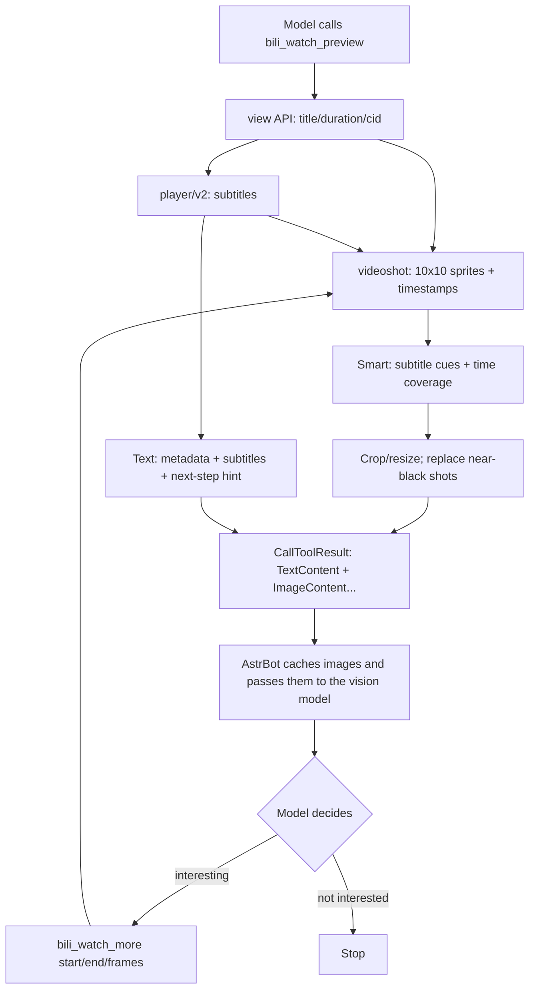

<div align="center">
  
  <h1>BiliWatch · Staged Bilibili video understanding</h1>
  <p>Preview 10 keyframes + subtitles, then let the model choose a segment or the whole video for a closer look.</p>
  <p>
    <strong>AstrBot</strong> ≥ 4.22 · <strong>License</strong> MIT ·
    <a href="README.md">中文</a>
  </p>
</div>

---

## What it does

Most Bilibili plugins only give the model **subtitles**, or extract a fixed number of frames. The model never gets a chance to look first and then decide whether a segment deserves a closer look.

BiliWatch turns “watching a video” into two LLM tool calls:

1. **`bili_watch_preview`** — extracts 10 keyframes plus subtitles for a whole-video preview.
2. **`bili_watch_more`** — if the model finds a segment interesting, it passes `start` / `end` / `frames` to look closer; use `start=0, end=0` for the whole video.

The per-call frame cap is controlled by `max_frames`. Set it to `0` to allow **every** storyboard frame.

It does **not** download the full video and does **not** require `ffmpeg` or `yt-dlp`. It only reads public Bilibili metadata, the official storyboard sprites, and subtitles.

## Features

- **Two stages, model-driven**: preview first, then choose a segment or the whole video.
- **Light dependencies**: only `aiohttp`, `Pillow`, and `mcp`, all bundled with AstrBot.
- **No video download**: uses Bilibili's official `videoshot` sprites; fast and disk-friendly.
- **Optional subtitles**: configure a Bilibili cookie to read Chinese / AI subtitles; visual preview still works without it.
- **Smart frame selection**: prefers frames near subtitle cues, then adds time coverage; no longer purely uniform.
- **Black-frame filter**: near-black shots are replaced by nearby storyboard frames when possible.
- **Subtitle alignment**: returns the cue count so the model can relate a timestamp to the matching line.
- **Configurable cap**: `max_frames=0` allows all frames; 20 / 40 / 60 are practical limits.
- **Read-only**: no comments, no dynamics, no account mutations.
- **Short cache**: storyboard/subtitle cache for 5 minutes per process to reduce duplicate requests and rate-limit risk.
- **No fake audio**: this plugin cannot hear BGM or tone; use a separate ASR pipeline if you need audio.

## Relationship to existing Bilibili tools

BiliWatch **only adds two LLM tools**. It does not replace, disable, or modify your existing Bilibili MCP tools:

- Existing `bili_subtitle` still works; BiliWatch also includes subtitles in its preview.
- Existing `bili_danmaku` still works; BiliWatch does not fetch danmaku, so keep using that tool for danmaku.
- `bili_comments` / `bili_rank` / `bili_hot_videos` and others are untouched.

Suggested split: **use BiliWatch for visuals, keep the original MCP for danmaku/comments**. Do not hammer the same video with preview + more + danmaku in a short window.

## Requirements

| Requirement | Required? | Notes |
|---|---|---|
| AstrBot | Yes | `>=4.22,<5`; tested on `4.29.1` |
| Vision-capable chat model | Yes | Frames are passed as images; a text-only model cannot see them |
| Bilibili cookie | Optional, recommended for subtitles | Stored in `bili_credential.json`; storyboard preview still works without it |
| Network | Yes | Access to `api.bilibili.com`, `i0.hdslb.com`, `aisubtitle.hdslb.com` |
| ffmpeg / yt-dlp | No | This plugin never downloads a video |
| Other plugins | No | No plugin dependencies |

> With DeepSeek, use a vision-capable model such as `deepseek-flash` (the tested setup). If the main model cannot accept images, the tool still returns images, but the model cannot interpret them.

### Cookie file format

Default: `data/plugin_data/astrbot_plugin_bili_watch/bili_credential.json` (relative, works on Linux/Windows; absolute paths are also accepted):

```json
{
  "sessdata": "your SESSDATA",
  "bili_jct": "your bili_jct",
  "buvid3": "optional",
  "dedeuserid": "your DedeUserID"
}
```

You can reuse the credential file from `adoresever/bilibili-mcp`, or copy the cookies from your browser after logging in to Bilibili (DevTools → Application → Cookies).

## Installation

### From the plugin marketplace (after publication)

Search **BiliWatch** in the AstrBot plugin marketplace and install it.

### From GitHub

```bash
cd ~/.astrbot/data/plugins
git clone https://github.com/QKqiuku/astrbot_plugin_bili_watch.git
```

Default Windows path:

```text
C:\Users\<you>\.astrbot\data\plugins\astrbot_plugin_bili_watch
```

### From a zip

Extract the zip so that `main.py` is directly inside the plugin folder:

```text
astrbot_plugin_bili_watch/
├── main.py
├── bili_core.py
├── metadata.yaml
├── _conf_schema.json
├── requirements.txt
├── README.md
├── README_en.md
├── LICENSE
├── CHANGELOG.md
└── logo.png
```

Then click **Reload plugins** in AstrBot, or restart AstrBot.

## Configuration

AstrBot → Plugins → **BiliWatch**:

| Option | Default | Description |
|---|---|---|
| `initial_frames` | `10` | Frames in the first preview; 6–10 recommended |
| `max_frames` | `40` | Per-call cap for the closer look; `0` = all frames allowed |
| `subtitle_max_chars` | `6000` | Max subtitle characters included; `0` = no truncation |
| `selection_mode` | `smart` | `smart` = subtitle cues + time coverage; `even` = uniform |
| `avoid_dark` | `true` | Try nearby frames when a shot is near-black |
| `frame_width` | `480` | Output frame width; 160×90 sources become 480×270 |
| `credential_path` | `bili_credential.json` | Relative paths resolve under `data/plugin_data/astrbot_plugin_bili_watch/`; absolute paths also work |

> Returning all frames can mean hundreds of images. Context size, cost, and latency grow quickly. Use `20–40` by default; set `0` only when you explicitly want a full-video pass.

## Usage

Enable these tools in the persona's tool list:

- `bili_watch_preview`
- `bili_watch_more`

### 1. Preview the whole video

Say:

> Use `bili_watch_preview` on BV1xrnz6gEVD and tell me what the video is about.

The tool returns:

- title, duration, uploader;
- page count, total storyboard frames, covered seconds;
- 10 keyframes at their timestamps (images);
- subtitles (if available);
- a next-step hint: call `bili_watch_more` for an interesting segment.

### 2. Look closer at a segment

> Use `bili_watch_more` on BV1xrnz6gEVD from 30s to 120s, 8 frames.

```text
bvid   = BV1xrnz6gEVD
start  = 30
end    = 120
frames = 8
```

### 2b. Look at exact timestamps

If the subtitles mention exact moments, pass `at` (comma-separated seconds):

> Use `bili_watch_more` on BV1xrnz6gEVD at 30, 90, and 150 seconds, 3 frames.

```text
bvid = BV1xrnz6gEVD
at   = "30,90,150"
```

`at` picks the nearest snapshot for each timestamp and ignores `start/end`.

### 3. Look at the whole video

> Use `bili_watch_more` on BV1xrnz6gEVD for the whole video, up to 60 frames.

```text
bvid   = BV1xrnz6gEVD
start  = 0
end    = 0
frames = 60
```

`frames=0` uses the configured `max_frames`; if `max_frames=0`, all frames are allowed.

### Does the model really choose?

Yes, through **LLM tool calling**, not hard-coded plugin rules:

- tool descriptions tell the model to preview first and use `more` only if needed;
- the preview text includes a next-step hint;
- the model decides based on frames and subtitles;
- the plugin only enforces `max_frames`.

If the model never asks for more, add a persona instruction such as:

> Preview first. Only look closer when there is a clear plot turn, something worth commenting on, or something worth sharing. Do not go full-video every time.

## How it works



- Bilibili `videoshot` samples frames based on visual changes, not every frame; source frames may be 160×90 or 480×270.
- The plugin crops each frame and resizes it to `frame_width` (480 by default, i.e. 480×270), encodes JPEG, and returns it as `ImageContent`.
- If the storyboard `index` is empty, the plugin reads `pvdata` (big-endian uint16 seconds) as a fallback; timestamps support seconds and milliseconds.
- AstrBot's local tool executor caches `ImageContent` and exposes it to the vision model.
- Subtitles come from `x/player/v2` and require a Bilibili cookie.
- Storyboard and subtitles are cached for 5 minutes to reduce duplicate requests.

## Limitations

- **Low resolution**: source frames are 160×90; upscaling cannot recover small on-screen text.
- **Not every frame**: Bilibili samples by scene change; fast actions may be missed.
- **No audio**: cannot hear BGM, tone, or sound effects; subtitles only cover what is said. Audio needs a separate ASR/Whisper pipeline.
- **Smart needs subtitles**: without subtitles, selection falls back to time coverage and is not much smarter than uniform.
- **No storyboard**: some videos have no snapshot sheet; the tool returns an error.
- **No subtitles**: some videos have no AI subtitles/CC, or the cookie has expired.
- **BV only**: BV numbers or links containing a BV number; `b23.tv` short links and `av` IDs are not resolved.
- **First P only**: multi-P videos currently use the default cid; extend the tool if you need per-P frames.
- **All frames are heavy**: `max_frames=0` can return hundreds of images and hit model limits.
- **Bilibili rate limits**: rapid requests may return 412 / -352; the plugin retries subtitles once and caches results, but keep usage reasonable.
- **Read-only**: no comments, dynamics, or account operations.

## Troubleshooting

### Plugin does not load

- Folder must be named `astrbot_plugin_bili_watch`;
- `main.py` must be directly inside it, not nested again;
- AstrBot must be `>=4.22,<5`;
- Reload plugins or restart AstrBot;
- Check `bili_watch` / tracebacks in the AstrBot log.

### “It only sees subtitles / no images”

- Confirm `bili_watch_preview` is enabled in the persona's tool list;
- Confirm the main model accepts image input;
- Look for this in the log:
  ```text
  Image returned and cached at path=...
  ```
- If there are only text results, the AstrBot version may be too old or the tool result was truncated; share the log.

### No subtitles

- Check that `credential_path` exists;
- The cookie may have expired; log in to Bilibili again and update it;
- The video may have no AI subtitles/CC;
- Bilibili may be rate-limiting; wait and retry.

### “This video has no storyboard”

- The video has no `videoshot` sheet;
- Try another video, or use subtitles only.

### Too many images / too slow

- Lower `max_frames` to 20–40;
- Do not use `0` unless you really want a full-video pass;
- Narrow `start` / `end` and extract again.

## Privacy and security

- Reads only public Bilibili metadata, storyboard frames, and subtitles; never writes comments or dynamics.
- The cookie is read from the local configured path; this project has no server and does not upload it anywhere.
- Keyframes and subtitles are sent to your configured LLM provider (e.g. DeepSeek) as part of the model request; check that provider's privacy policy.
- Never commit a cookie file to GitHub.

## Development

```bash
# Offline unit tests
python -m unittest discover -s tests -v

# Syntax check
python -m py_compile main.py bili_core.py
```

Live integration check (network + cookie required):

```python
import asyncio
from bili_core import prepare

async def main():
    pack = await prepare(
        "BV1xrnz6gEVD",
        r"D:\bilibili-mcp\bili_credential.json",
        initial=True,
        initial_frames=10,
        max_frames=10,
    )
    print(pack["total_frames"], len(pack["images"]), len(pack["subtitle"]))

asyncio.run(main())
```

Project layout:

```text
astrbot_plugin_bili_watch/
├── __init__.py          # Python package marker; can be empty
├── main.py              # AstrBot Star + two LLM tools
├── bili_core.py         # Bilibili API, frame selection, cropping, subtitles
├── _conf_schema.json    # Plugin configuration
├── metadata.yaml        # Marketplace metadata
├── tests/               # Offline unit tests
├── logo.png
├── README.md
├── README_en.md
├── LICENSE
└── CHANGELOG.md
```


## License

[MIT](LICENSE) © 2026 QKqiuku

---

[中文 README](README.md)
